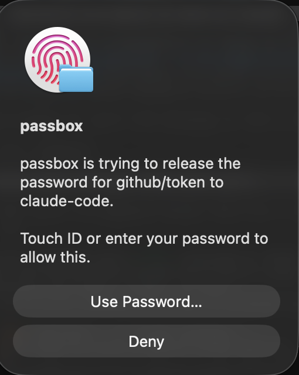

# passbox

[](https://github.com/gabrielkoerich/passbox/actions/workflows/ci.yml) [](https://github.com/gabrielkoerich/passbox/releases/latest) [](https://github.com/gabrielkoerich/homebrew-tap) [](https://crates.io/crates/passbox) [](LICENSE)

A password store for machines that run agents. An agent asks for a secret, macOS raises a Touch ID prompt naming the agent and the secret, and the value goes into one child process rather than into the agent.

<p align="center">
  
</p>

Secrets are ordinary [age](https://age-encryption.org) files. The broker decides who may open them. See [docs/content/design.md](docs/content/design.md) for why it is built this way and what it costs.

It runs without an Apple Developer Program membership.

> This is a new way to store passwords: a fingerprint releases one or more secrets into one process. It is young and may have bugs. Keep another copy of anything you cannot lose.

## Install

```bash
brew install gabrielkoerich/tap/passbox
passbox init
```

Recent Homebrew asks you to trust a third party tap before it will build from one. If the install stops and says so, run `brew trust --formula gabrielkoerich/tap/passbox` and try again.

The formula downloads a prebuilt binary and compiles nothing, so you do not need Rust.

Or build it from [crates.io](https://crates.io/crates/passbox), which needs Rust and the Command Line Tools for `swiftc`. You do not need a full Xcode.

```bash
cargo install passbox
```

On the Mac, passbox needs Touch ID and macOS 13 or later. The Homebrew formula is for Apple silicon only, and the menu-bar app needs macOS 14.

`init` binds the store to this Mac's Secure Enclave and asks for nothing else. There is no passphrase, so there is no file anyone can carry off and grind at.

The cost: the store opens on this Mac only. Lose the Mac and the secrets are gone. Sync adds a way back, and it is off until you turn it on.

### On Linux

Take the binary from a [release](https://github.com/gabrielkoerich/passbox/releases):

```bash
curl -sSfL -o passbox.tar.gz \
  https://github.com/gabrielkoerich/passbox/releases/latest/download/passbox-x86_64-unknown-linux-musl.tar.gz
tar -xzf passbox.tar.gz && sudo install passbox /usr/local/bin/
```

Or build it with `cargo install passbox --no-default-features`.

The release binary is statically linked against musl, so it runs on any distribution regardless of its glibc. Both are the client build: no Secure Enclave, no broker and no `sync`. On its own it opens a store with a passphrase. To have a Mac approve each read with its fingerprint instead, see [Another machine](README.md#another-machine).

## Use

```bash
printf 'ghp_xxx' | passbox add github/token
passbox ls
passbox get github/token      # prints it, for a terminal
passbox copy github/token     # to the clipboard, cleared after 20 seconds
```

`get` writes the secret to stdout, so it refuses when stdout is not a terminal, where the value would land in a pipe, a file or an agent's context. No flag overrides that. For the clipboard use `copy`, which marks the entry so clipboard managers skip it and clears it after 20 seconds, or after `--clear N` seconds up to 60. For a command use `exec`.

`add` refuses a name that already exists. To change a value, `passbox rm` it and add it again. The old value stays in its versions, so `passbox restore` brings it back.

### Alfred

The [Alfred workflow](integrations/alfred) copies a secret through `passbox copy`. Type `pbx`, press `⏎` and touch the sensor. Alfred reopens with your names: pick one, then press `⏎` to copy the password or `⌘⏎` to copy the username. It needs the Powerpack.

```bash
curl -fsSLO https://github.com/gabrielkoerich/passbox/releases/latest/download/passbox.alfredworkflow
open passbox.alfredworkflow
```

### Mac app

The [menu-bar app](app) opens a search panel on `⌘⇧Space`. `⏎` copies the password and `⌘⏎` the username, through `passbox copy`. It lists the names once and keeps them in memory, so later searches need no fingerprint. It needs macOS 14 and builds with the Command Line Tools alone:

```bash
app/build.sh dev ~/Applications/passbox.app
open ~/Applications/passbox.app
```

### SSH keys

The broker is also an SSH agent. Add a key as a secret, point `SSH_AUTH_SOCK` at the broker, and every signature asks for your fingerprint. The private key never leaves the broker.

```bash
passbox add ssh/github < ~/.ssh/id_ed25519
export SSH_AUTH_SOCK=~/.passbox/ssh-agent.sock   # in ~/.zshrc
ssh-add -L                                        # lists it, no prompt
```

The agent takes unencrypted Ed25519 and P-256 keys only. Remove a passphrase with `ssh-keygen -p -f KEY`, then delete the file once the key is in the store. The prompt says what is signed and with which key, such as "sign an SSH login as git with SSH key you@mac for ssh". A key synced from another Mac is offered once `passbox ls` has run on this one. Git commit signing with `gpg.format ssh` goes through the same agent. The agent needs the broker running, which the [LaunchAgent](#on-the-mac) keeps up.

### Coming from pass

```bash
passbox import-pass              # everything
passbox import-pass acme        # one namespace
passbox import-pass acme/token  # one entry
```

passbox decrypts each entry through GPG and re-encrypts it to the store key. It keeps the whole body, so the `key: value` lines many pass entries carry under the password survive. It skips entries already in the store, and it changes or removes nothing in `pass`.

### Giving a secret to an agent

The value goes into one child process and never into the agent.

```bash
passbox exec --env GITHUB_TOKEN=github/token -- gh api /user
passbox exec --stdin docker/token -- docker login -u me --password-stdin
```

Prefer `--stdin` where the tool accepts it. Any process running as you can read a child's environment with `ps eww`.

Set `PASSBOX_AGENT` to name the caller in the prompt. Without it, passbox reads the process chain and uses the first ancestor that is not a shell, such as `claude` or `codex`.

```bash
PASSBOX_AGENT=claude-code passbox exec --env GH_TOKEN=github/token -- gh pr list
```

The prompt then reads `passbox is trying to release the password for github/token to claude-code.` macOS writes the opening clause from the binary name, and passbox writes the rest.

### Through MCP

An agent asks through tools rather than a shell, and the tools cannot hand it a value at all.

```bash
claude mcp add passbox -- passbox mcp          # Claude Code
codex mcp add passbox -- passbox mcp           # Codex
```

Any client that speaks MCP over stdio works, and the command is always `passbox mcp`. For one configured by file:

```json
{
  "mcpServers": {
    "passbox": { "command": "passbox", "args": ["mcp"] }
  }
}
```

That file is `~/.claude.json` for Claude Code, `~/.codex/config.toml` for Codex in TOML form, and `~/.cursor/mcp.json` for Cursor. Check it took with `claude mcp list`.

The server has two tools of its own, and neither returns a secret. Each installed plugin adds its tools beside them. See [Plugins](README.md#plugins).

| Tool | Returns |
|---|---|
| `list_secrets` | names only |
| `run_with_secret` | the command's output, with the value scrubbed out of it |

There is no `get_secret`. A tool result lands in the model's context, where it is logged and sent onward, so the tools run the command for the agent. If the command prints the secret anyway, passbox replaces it in the output before returning.

The agent name in the prompt comes from the MCP handshake, so it is the client's own `clientInfo.name` rather than a guess up the process tree.

#### Grants and MCP

The MCP server is a client of the broker like anything else, so a token works the same way: `PASSBOX_TOKEN` in the server's environment covers the secrets it was granted, and those reads stop prompting.

The server inherits the environment of whatever launched it, which for an editor is the editor itself. So the token has to be in the MCP entry rather than your shell:

```json
{
  "mcpServers": {
    "passbox": {
      "command": "passbox",
      "args": ["mcp"],
      "env": { "PASSBOX_TOKEN": "..." }
    }
  }
}
```

The cost is a bearer token in a config file. It is worth it for an agent that reads the same few secrets all day and otherwise prompts on every call. For an agent that reads a secret now and then, take the prompt instead.

[`examples/mcp`](examples/mcp) speaks the protocol to `passbox mcp` from Python with no SDK, and holds a project `.mcp.json`. Models that need the whole MCP guide in one place can read [`llms.txt`](llms.txt).

A token changes only whether you are asked. It cannot widen what the tools refuse: `list_secrets` still returns names only, `run_with_secret` still runs the command, and there is still no `get_secret`.

Tokens live in the broker's memory, so restarting it revokes every one of them and the MCP server goes back to prompting. The MCP server itself needs no restart.

### Approving a project once

A project declares what it needs in `.passbox.toml`:

```toml
secrets = ["github/token", "npm/token"]
window_secs = 3600
```

The first time an agent working in that directory asks for one of them, passbox shows a single prompt covering the whole list, and does not ask again for the window. The default is an hour and the cap is twelve.

**The file is a request, not a grant.** An agent can write one itself, so nothing is approved until you put your finger on the sensor. The approval is bound to the file's SHA-256: add a secret to the list and the hash changes, so it asks again.

The project is the caller's working directory, read from the kernel rather than taken from the request, so a caller cannot point at a manifest somewhere else. Grants live in `grants-<host>.age`, encrypted, and never sync.

#### `.passbox.toml` and `.env.passbox` are different files

The names are similar and the jobs are different. A project can have both, and they work together.

| | `.passbox.toml` | `.env.passbox` |
|---|---|---|
| Answers | may this project ask for these | which variable gets which secret |
| Read by | the broker, when deciding | your program, at startup |
| Effect | one prompt covers the list, for a window | populates `process.env` or equivalent |
| Approval | yes, bound to the file's hash | none, it is a lookup table |
| Safe to commit | yes, it names secrets and grants nothing | yes, same |

The `.toml` changes how often you are asked. The `.env` says where a value lands once you have it. Neither holds a value, so you can commit both, and neither grants anything on its own.

If a project uses both, the `.toml` covers the same names the `.env` maps, so the one prompt covers the whole startup.

### Seeing what was released

```bash
passbox audit --tail 50
```

Every decision is logged, encrypted, one record per line, with the agent, the secret and the caller's process chain. A `granted`, `delegated` or `by token` record also carries `grant`, the id of the approval behind it, so every read through a token or its children traces back to one fingerprint. A plugin record that is `approved`, `by window` or `released` also carries `args`, the call's arguments as its prompt showed them, such as `query="invoice" mailbox="INBOX"`.

| Decision | Meaning |
|---|---|
| `released` | A prompt was approved and the value went out, to a caller or a plugin's stdin |
| `signed` | A prompt was approved and an SSH key in the store signed |
| `by token` | A grant token covered the read, no prompt |
| `granted` | A grant was approved for this name |
| `delegated` | A child token was minted from a live token, no prompt |
| `project grant` | A `.passbox.toml` grant covered the read |
| `approved` | A listing or a plugin run was approved |
| `by window` | A plugin call ran inside an approval window from `config.toml`, no prompt |
| `unknown` | The prompt was approved, and no secret or SSH key has that name |
| `denied` | The prompt was refused |
| `prompt failed` | No prompt could be shown, such as with the lid closed, or it did not complete |

## Plugins

A plugin adds gated reads of a local app, such as Mail or Things 3. Each read is a tool, so an agent runs it behind the same Touch ID prompt and audit log as a secret read. A plugin returns data and never acts for the caller: there is no tool that sends, adds, writes or pushes.

```bash
passbox plugin add mail                         # first-party, bundled in the binary
passbox plugin list                             # installed plugins and their tools
passbox plugin mail recent --count 5            # run a tool, approved and audited
passbox plugin remove mail
```

The same tools appear over MCP as `mail.recent`, `mail.search` and so on, so an agent calls them through the server. Every call prompts, unless a [window](#approval-windows) you set covers it. The broker approves and audits, and the caller runs the command, so the command keeps your GUI session. A value is passed as a whole argument to the command, never spliced into a script, so it cannot become code.

First-party plugins:

| Plugin | Needs | Tools |
|---|---|---|
| `mail` | Mail.app, nothing to install | `recent` in the Inbox, `search` in every mailbox |
| `calendar` | the `icalBuddy` CLI | `today`, `agenda` |
| `things3` | the `things` CLI | `inbox`, `today`, `search`, and for jobs that parse JSON `today_json`, `inbox_json`, `search_json`, `upcoming`, `logbook`, `completed`, plus `all` and `trash` |
| `imap` | `/usr/bin/python3` from the Command Line Tools, an account entry in the store | `recent`, `search`, `read`, `attachments` |

`mail` drives Mail through `osascript`, which ships with macOS. The first read raises the macOS automation prompt for Mail once.

`calendar` and `things3` shell out to a CLI, so each has to be installed:

```bash
brew install ical-buddy                          # calendar
brew install ossianhempel/tap/things3-cli        # things3
```

`calendar` uses icalBuddy rather than raw AppleScript, because AppleScript reports a recurring event's series start instead of the occurrence date.

A remote calendar call runs icalBuddy inside the broker, so the first one shows a one-time macOS prompt asking to allow passbox to access your calendars. Allow it, or the call returns "No calendars". The grant is tied to the binary's signature, and the release binary is ad hoc signed, so macOS may ask again after an upgrade.

`imap` reads any IMAP server, such as Proton Mail through Bridge. It is one Python 3 script that uses only the standard library. Its account is one store entry, `mail/imap`. The broker writes it to the script's stdin, so the password is never a parameter, an argument, an environment variable or a file, and it never leaves the broker:

```bash
passbox add mail/imap --field host --field port --field user --field tls --field fingerprint
passbox plugin add imap
passbox plugin imap recent --count 5               # id | date | from | subject
passbox plugin imap search --query invoice
passbox plugin imap read --id 4021
passbox plugin imap attachments --id 4021 > attachments.json
```

The entry's first line is the password, then fields:

```text
bridge-password-here
host: 127.0.0.1
port: 1143
user: me@example.com
tls: starttls
fingerprint: 3a:1f:...:9c
```

`tls` is `starttls` or `ssl`. Left out, it is `ssl` on port 993 and `starttls` on any other port, and a missing port is 993 for `ssl` and 143 for `starttls`. passbox refuses plain IMAP and verifies certificates against the system roots. A server with a self-signed certificate, such as Bridge, is trusted through one pinned certificate instead: `fingerprint` is its SHA-256, compared before the password is sent, or `cafile` is the path to its exported PEM. Every tool takes an optional `--mailbox`, `INBOX` by default. `attachments` returns the message's attachments as one JSON array of `name`, `type`, `size` and `base64`, up to 10 MB a call, so nothing is written on the Mac and a remote caller gets the bytes itself. Past that limit an attachment is listed with `skipped` in place of `base64`. Each name keeps only its base name, so a caller that saves it under that name stays in its own directory.

For Proton Mail, install and sign in to [Proton Mail Bridge](https://proton.me/mail/bridge). Bridge shows the IMAP host, port, user and a Bridge password for the account, which is not your Proton password. Read the certificate fingerprint from Bridge itself:

```bash
openssl s_client -starttls imap -connect 127.0.0.1:1143 </dev/null 2>/dev/null \
  | openssl x509 -noout -fingerprint -sha256
```

Put those values in the `mail/imap` entry as above, the fingerprint as openssl prints it or as bare hex. The prompt for each run names `mail/imap`, and the audit log records it as `released`. Every run, from the CLI, MCP or a client on the tailnet, happens inside the broker on the Mac, and only the mail comes back. A headless store with `PASSBOX_PASSPHRASE` has no broker, so there the CLI runs it the same way. The broker runs only the copy bundled in the binary: if the installed `imap.py` or `plugin.toml` differs from it, the run is refused before the prompt until you run `passbox plugin update imap`.

There is no plugin for sending mail, adding a todo, git or gh. A job that sends mail uses its own client and gets the SMTP password from `passbox exec`, for example `passbox exec --env SMTP_PASSWORD=mail/smtp -- ./send-report`. An agent runs git and gh itself, so a plugin for them gated nothing. Gate git through the [SSH agent](#ssh-keys), which prompts for every signature, and give gh its token for one command with `passbox exec --env GH_TOKEN=github/token -- gh pr create`.

A tool whose command is missing is refused before it prompts, with the install line above.

Write your own plugin as a directory with a `plugin.toml`, then `passbox plugin add <dir>`. A tool declares its `params` and a `run` command where `{param}` is one whole argument. Mark a tool that only reads with `readonly = true`, so a window can cover it. Every first-party tool is marked.

A tool can also declare `limits`, checked on every path before any prompt. A value that breaks one is refused with the parameter and the limit named, and an omitted optional is not checked.

```toml
[[tool]]
name = "read"
readonly = true
params = ["id", "mailbox?"]
limits = { id = { digits = true }, mailbox = { max_len = 100 } }
run = ["/usr/bin/python3", "-I", "-c", "imap.py", "read", "{id}", "{mailbox}"]
```

| Limit | Allows |
|---|---|
| `max = 50` | a whole number from 0 to 50 |
| `max_len = 200` | at most 200 characters |
| `digits = true` | digits only, such as a message id |
| `date = true` | a date such as `2026-01-31` |

The first-party tools cap `count` at 50, `query` at 200 characters, `mailbox` at 100, calendar `days` at 31 and Things 3 `limit` at 100, take an IMAP message id as digits only, and take `modified_after` as a date.

A first-party plugin can name one store secret with `stdin = "<secret name>"`. Such a plugin runs only inside the broker and only as its bundled copy. Each run prompts naming the secret, audits it as `released`, writes it to the tool's stdin and closes it, and returns the tool's output with the secret scrubbed out. A request that asks only for approval is refused, so the value never goes back to a caller. A plugin you write yourself cannot read a secret: one with `stdin` is refused. Run it under `passbox exec` instead.

Each plugin carries a `version`. `passbox plugin update <name|dir>` refreshes an installed plugin, and `plugin list` flags a first-party plugin whose bundled version differs from the installed copy, which is what happens after a `brew upgrade`.

### Approval windows

Every plugin call prompts. A job that reads Things 3 every few minutes would need a finger each time, so `~/.passbox/config.toml` can open a window for a named tool:

```toml
[plugins.windows]
"things3.logbook" = "24h"
"things3.upcoming" = "24h"
"imap.search" = "1h"
```

The prompt shows the call's arguments, such as `run plugin:imap.search query="invoice" mailbox="INBOX" for claude, releasing mail/imap`, and the window covers that exact call. After one approved call, later calls of that tool with the same arguments skip the prompt until the window ends, and each is audited as `by window`. A call with another query, mailbox or message id prompts, and approving it opens a window of its own. A window is a duration in `s`, `m` or `h`, capped at 24 hours like a grant.

The cost: a job that repeats one call, such as `things3.logbook` or `imap.recent --count 20`, prompts once per window, and a job whose query changes prompts on every call. An omitted optional and an empty one are the same call. The broker holds at most 256 windows per scope and drops the oldest first.

- A key names one plugin and one tool, in quotes. `things3`, `*` and `things3.*` are refused, and so is a plugin that is not installed or a tool it does not have.
- Only a tool marked `readonly = true` can have a window. A key naming any other tool is refused.
- For a plugin without `stdin`, such as `mail` or `things3`, the broker approves and your local caller runs the command, so the binding holds only for callers that go through passbox. Any process of yours can run the app's own CLI without passbox. It is enforced where the broker runs the command: a plugin with `stdin` such as `imap`, and every call from a tailnet client.
- A window covers the caller that opened it. A tailnet client is named by `tailscale whois`, so one host's window does not cover another host. Every caller on the Mac is one scope, and it does not cover a tailnet client.
- The file is plain text that any process of yours can edit. The broker keeps the hash of the section you approved, and of each named tool's command. An edit takes effect only after one prompt that lists the new windows, such as `allow plugin windows things3.logbook 24h, imap.search 1h for claude, then run plugin:things3.logbook for claude`. Approving it ends the windows opened under the old section, and a refused prompt keeps the old section.
- Windows live in the broker's memory, so a restart ends them. The approved hash survives it.
- A plugin with `stdin`, such as `imap`, still runs inside the broker on every call in the window, from its checked bundled copy, and each call audits the secret as `released`. The window holds the secret in the broker's memory, as a token does, and the output never holds it.

A bad section is refused with the reason on the next plugin call, before any prompt. See [docs/content/design.md](docs/content/design.md#plugin-windows) for what a window costs.

## Backup and sync

git carries the encrypted secrets and nothing that opens them.

```bash
passbox git init
passbox git remote add origin git@github.com:you/passbox-store.git
```

After that every write commits on its own, the way `pass` does: `add`, `rm`, `restore`, `import-pass` and `yubikey-add`. Once the repo has a remote, every write also pushes, so no change lives on this Mac alone. A failed push warns and the write still succeeds. Nothing happens until you run `git init`.

A second Mac clones instead of running `git init`, so both share one history: `git clone <remote> ~/.passbox`, then `passbox machine add`. `passbox git pull` fetches the other Mac's writes.

**A write also updates the copy.** Once `sync --enable` has chosen a directory, every write copies to it, because nobody remembers to run `sync`, and a secret that exists only on this Mac can be lost. A delete travels too, as a tombstone.

This applies only to a directory, where the copy takes a few milliseconds. An rclone remote is a slow round trip and stays on `passbox sync`. It is best effort: the value is already written and encrypted, so an unplugged USB stick warns rather than failing the command. `PASSBOX_NO_AUTOSYNC=1` turns it off for a script that writes in a loop.

Commit subjects name the operation and never the entry, because a subject naming a secret would undo the work of keeping names out of filenames.

**What history costs.** `passbox rm` writes a tombstone and prunes after 90 days, so a secret is gone. Git keeps it: the old `.age` blob stays in the history, still readable by the store key. `pass` makes the same trade, so make it knowingly.

Git and sync are not alternatives. With both set up a write does both, and they answer different questions: the repo is this machine's history, the copy is what survives the machine. The repo is never copied to the mirror, because a shared directory holding two machines' git internals would be a mess, and the remote is a mirror rather than a clone.

The Secure Enclave wraps are excluded, so the remote holds opaque age files that only this Mac can read. That protects you from deleting a secret by accident. It does not protect you from losing the Mac, because nothing in the backup can open it. For that, turn on sync.

### Sync

Sync is off, and nothing leaves the Mac until `passbox sync --enable` chooses a destination. After that a write copies to a directory destination, as above, and `passbox sync` pulls and pushes. There is no timer.

```bash
passbox sync --enable
passbox sync
```

`--enable` asks two questions.

The first is how a second machine gets in, a YubiKey or a passphrase. See [If you lose the Mac](#if-you-lose-the-mac).

The second is where the copy goes:

```
Where should the copy go?

  1) iCloud Drive, a folder on this Mac that Apple replicates
  2) A directory you name, such as a USB stick or Dropbox
  3) A git remote, which also gives you history
  4) An rclone remote, for S3, B2, Drive and the rest
```

The answer is written to `~/.passbox/config.toml`, so later runs of bare `passbox sync` go to the same place. Running `--enable` again shows the current destination and offers to change it. `PASSBOX_REMOTE` or `--remote` overrides one run without changing the file.

```toml
[sync]
engine = "icloud"        # icloud | directory | git | rclone
directory = ".passbox"   # icloud: one folder in iCloud Drive, .passbox when left out
# path = "/Volumes/usb/passbox"         directory: an absolute path
# remote = "git@github.com:you/s.git"   git, or "b2:passbox" for rclone
```

The same file holds the [plugin windows](#approval-windows) in `[plugins.windows]`, which `--enable` keeps when it rewrites `[sync]`. To move the copy, edit one line. The file stays on this Mac and is never synced, since a USB path on one Mac means nothing on another. The older one-line `~/.passbox/remote` is deprecated. It is still read when there is no config, with a warning, and stops being read in v3. `passbox sync --enable` moves it to the config, with the same destination.

**A destination that makes no sense is refused.** passbox checks the config on every read and stops with the reason, instead of copying somewhere new:

- the file is not valid TOML, names an unknown engine or key, or misses the key its engine needs;
- a value is empty, has a space at either end, or holds a control character such as a newline;
- the iCloud `directory` is not one folder name, or a `path` is not absolute;
- the folder does not exist. Only `--enable` creates it, so a path changed by accident or an unplugged USB stick never gets a fresh copy;
- the folder overlaps the store, or holds other files and no passbox copy.

A write that cannot reach its copy still succeeds and says why it was not copied.

| Answer | Goes to | Needs |
|---|---|---|
| iCloud Drive | `~/Library/Mobile Documents/com~apple~CloudDocs/.passbox`, hidden in Finder until `cmd-shift-.` | nothing |
| a directory | wherever you say | nothing |
| a git remote | `~/.passbox` made a repo, pushed on each sync | `git` |
| an rclone remote | any of rclone's backends | `rclone` |

iCloud Drive is an ordinary directory on macOS, so the default path is a directory to directory copy. It needs no account, no rclone and no network code.

The config names the kind with `engine`. A destination given with `--remote` or `PASSBOX_REMOTE` has no engine, so passbox tells it apart by shape. A remote starting `git@`, `ssh://` or `https://`, or ending `.git`, is git. One starting `/`, `~` or `.` is a directory. Anything else holding a colon goes to `rclone bisync`. The rest is a directory.

Git commits after the copy, which gives you history and an off-site remote.

On a second Mac, run `passbox sync` then `passbox machine add`, the same steps as recovering onto a replacement.

### If you lose the Mac

By default there is no way back. `init` binds the store to this Mac's Secure Enclave and writes no other wrap, so the key exists in one place and cannot leave it.

**Time Machine does not help.** It copies `wraps/se-<host>.json` faithfully, and the file is inert anywhere else. The private half never leaves the Enclave. Erasing the Mac destroys the Enclave keys, so a restore onto a wiped machine finds files it cannot open. Only a restore to the same Mac, not erased, still works.

To have a way back, turn on sync. It asks how the copy should be opened, writes that wrap, then asks where the copy goes.

```bash
passbox sync --enable
```

```
That copy needs a way in. Two choices:

  1) A YubiKey. Nothing in the copy can be attacked, and you keep the token.
  2) A passphrase. Works anywhere, and anyone holding the copy can grind it.
```

Choosing the token handles the rest: it offers to install `age-plugin-yubikey`, and asks before provisioning a slot, because that changes the hardware.

If you pick the passphrase, anyone holding the copy can attack that wrap offline at their own pace. passbox refuses a passphrase under 12 characters. Use five or six diceware words.

A wrap only helps where the copy reaches. A USB stick in the same bag as the Mac survives neither a fire nor a theft.

### A YubiKey instead of a passphrase

A passphrase wrap is the one file in a synced copy worth attacking. A YubiKey wrap has nothing to grind, because the private half stays in the token.

`passbox sync --enable` does the whole setup. One token is one way back, so add a second as a backup. A YubiKey cannot be copied, so the backup is a second token with its own identity, added to the same wrap. Plug it in and run:

```bash
passbox yubikey-add                    # the plugged token the store does not hold yet
passbox yubikey-add age1yubikey1...    # or name the recipient from --list
```

With no recipient, passbox lists every plugged token and drops the ones the store already holds. A token with no identity gets the same setup as `sync --enable`, but only when no plugged token has one, so unplug the old token first. If several new tokens are plugged in, it shows each serial and asks. It then offers to check the new token by opening the wrap with that token alone.

passbox uses the PIV applet. OpenPGP keys live in a separate applet on the same chip and are never touched. Before provisioning a slot it reads what PIV already holds and shows you, using `ykman` when it is installed.

### When the YubiKey will not cooperate

Five failures give an error that names neither the cause nor the fix. They are listed in the order you are likely to meet them.

**`Failed to authenticate with the PIN-protected management key`**

Firmware 5.7 sets the PIV management key algorithm to AES192, and `age-plugin-yubikey` supports TDES only. A factory reset does not help, because the reset sets AES192 too, so a brand new token arrives in this state.

```bash
ykman piv info | grep "Management key algorithm"   # AES192 means read on
ykman piv access change-management-key -a tdes \
  -n 010203040506070801020304050607080102030405060708
```

When `ykman` is installed, passbox checks this before it asks the plugin for anything, so it says which algorithm is set rather than failing inside the plugin.

**`Error while communicating with YubiKey: authentication error`, after the touch**

GPG's `scdaemon` opens the smart card exclusively and holds it. It lands between the plugin's key generation and its certificate write, and the write comes back as an authentication error. Anything that calls `pass` starts it again, including a scheduled job, so it can reappear mid-operation.

```bash
gpgconf --kill scdaemon
```

passbox offers to do this before generating. If something on a timer keeps restarting it, stop that first.

**The touch never registers**

On a 5C Nano the contact sits flush in the port and is hard to reach. The plugin waits, gets nothing, and reports it as an authentication error.

```bash
age-plugin-yubikey --generate --touch-policy never
```

For a Nano this is the right setting, since the form factor is made to stay in a port. The PIN still applies, so a stolen token is useless without it.

**A prompt appears and the PIN is refused**

If generation failed *after* the plugin's PIN-change step, your PIN is already the new one even though nothing was provisioned. Retrying with the old PIN burns attempts, and three wrong tries locks the applet. Check `ykman piv info` for `PIN tries remaining` before retrying, and reset rather than guess:

```bash
ykman piv reset       # needs no PIN, wipes the PIV applet only
```

A reset leaves your OpenPGP keys and their PIN untouched. Set TDES again afterwards.

**A half-provisioned slot**

A failed generation can leave a private key with no certificate. `ykman piv info` shows the slot; `ykman piv keys delete <slot>` clears it, or `ykman piv reset` clears everything.

### Recovering on a replacement Mac

```bash
brew install gabrielkoerich/tap/passbox
cp -R ~/Library/Mobile\ Documents/com~apple~CloudDocs/.passbox ~/.passbox
passbox machine add
```

`machine add` asks for a touch on the YubiKey, or for the recovery passphrase when there is no YubiKey wrap, then binds the new Mac's Enclave, so reads go back to asking for a fingerprint.

Rejected: backing up the Enclave key itself. It cannot be exported, which is the property that makes a stolen copy of the store useless.

## Unattended

A daemon cannot answer a fingerprint prompt at 3am, so the goal is that it never has to read passbox at all after it starts.

### Inject at launch, and stop reading

Try this first. One approval, and the value lands in the process environment where every child inherits it:

```bash
passbox exec --env GITHUB_TOKEN=github/token -- ./your-daemon
```

Several `--env` and `--stdin` secrets share one approval: `exec` grants them together for 30 seconds and reads each through that token, and if the grant is refused it falls back to one prompt per secret.

Nothing shells out to passbox again for the life of that process, so it runs for weeks on one fingerprint and needs you only when you restart it. This works with no code change wherever a credential layer already prefers an environment variable over its providers.

Cost: the value sits in the environment for the process's lifetime, and anything running as you can read it with `ps eww`. Use `--stdin` where the child takes a secret that way.

### A grant, for what cannot be injected

Some secrets have no usable variable name, and some jobs pick what they read at runtime. For those, one approval mints a **token** that opens exactly the secrets it was granted, to whoever holds it, until it lapses:

```bash
export PASSBOX_TOKEN=$(passbox grant acme/signing-key acme/api-key --for 86400)
```

The token goes to stdout only and the covered names to stderr, so `$(...)` captures the token alone. It never goes to stderr, which lands in scrollback, CI logs and agent transcripts. Reads that present it are audited as `by token`.

**A namespace is refused.** `grant acme` would hand over everything under it to save one prompt, and it scopes on how the store happens to be laid out rather than on what the job reads: put everything at the root and a namespace rule protects nothing.

```bash
passbox grant acme
passbox: acme is a namespace holding 9 secrets, ask for the ones this needs:
  acme/api-key
  acme/signing-key
  ...
```

The refusal lists them, so you can copy the names from it. When the broker's key is still warm from a recent read, the refusal comes before any prompt. Otherwise it comes after one.

**24 hours is the ceiling** and it cannot be raised. A token that never lapses would work like a password. A job that must run unattended with no end date should use injection.

Restarting the broker revokes every outstanding token:

```bash
pkill -f "passbox broker"
```

### A supervisor that starts its own workers

A daemon that starts workers holds one parent token and gives each worker a child for that worker's names only. A child mints with no prompt when every name is in the parent and it ends no later than the parent. Without `--for` it ends when the parent does. One grant holds at most 64 live children. Anything wider prompts like any grant.

```bash
parent=$(passbox grant w1/key w2/key --for 86400)        # one fingerprint a day
child=$(printf '%s\n' "$parent" | passbox grant --token-stdin w1/key)
printf '%s\n' "$child" | docker run -i worker passbox exec --token-stdin --env KEY=w1/key -- ./work
```

`--token-stdin` reads the token from the first line of stdin, so it is never in an environment or a file, where `docker inspect` and `ps eww` would read it. `exec` leaves the rest of stdin to its child. Each mint is audited as `delegated`, with the parent's grant id.

Cost: a leaked child opens its worker's names until the parent lapses, and the supervisor's memory holds the parent, which opens every name.

### Mint once per process

A token caches on the client that minted it. A factory that builds a fresh client per call mints a fresh grant per call, and each one is a fingerprint. Memoise it. The symptom is repeated `granted` for one secret and one agent in `passbox audit`.

## Another machine

A Linux box with no Secure Enclave can read a secret held by a Mac. The fingerprint happens on the Mac; the client holds no store and no key, so a copy of it is worth nothing.

Verified from a Raspberry Pi on a LAN and a fly.io machine in another country, both over Tailscale.

### On the Mac

The broker has to be **already running, in your login session**. One started by an incoming connection cannot raise a Touch ID prompt: whoever calls `evaluatePolicy` has to be somewhere a sensor is reachable. A LaunchAgent is how you get that.

A Homebrew install ships one. Start it as your user, not with sudo, since a sudo service has no login session:

```bash
brew services start passbox
```

For a build from source, write `~/Library/LaunchAgents/com.you.passbox.broker.plist`:

```xml
<?xml version="1.0" encoding="UTF-8"?>
<!DOCTYPE plist PUBLIC "-//Apple//DTD PLIST 1.0//EN" "http://www.apple.com/DTDs/PropertyList-1.0.dtd">
<plist version="1.0">
<dict>
  <key>Label</key><string>com.you.passbox.broker</string>
  <key>ProgramArguments</key>
  <array>
    <string>/opt/homebrew/bin/passbox</string>
    <string>broker</string>
  </array>
  <key>EnvironmentVariables</key>
  <dict>
    <key>PATH</key><string>/usr/local/bin:/opt/homebrew/bin:/usr/bin:/bin</string>
  </dict>
  <key>RunAtLoad</key><true/>
  <key>KeepAlive</key><true/>
  <key>StandardErrorPath</key><string>/tmp/passbox-broker.log</string>
</dict>
</plist>
```

Set `PATH` explicitly. A LaunchAgent gets a minimal one, `tailscale` is not on it, and the broker then starts with no tailnet listener and says nothing about why.

Load it, then forward the tailnet port to the broker. The `serve` step applies to either kind of LaunchAgent:

```bash
launchctl bootstrap gui/$(id -u) ~/Library/LaunchAgents/com.you.passbox.broker.plist
tailscale serve --bg --proxy-protocol 1 --tcp 8787 tcp://127.0.0.1:8787
```

### Why `serve` rather than binding the tailnet address

The broker binds `127.0.0.1:8787` and Tailscale forwards to it. Binding the 100.x address directly looks right and does not work: macOS runs Tailscale as a network extension, the socket accepts the connection, and the first read fails with `ENOTCONN`. Measured 2026-09-27, and reproduced with a plain Python server, so it is the platform rather than passbox.

Cost: loopback has none of the unix socket's `0600` protection, so any local user can reach that port. It is the only inbound path macOS delivers.

`--proxy-protocol 1` makes Tailscale open each connection with the node's tailnet address, since through `serve` the broker only ever sees `127.0.0.1`. The broker resolves that address with `tailscale whois`, so the prompt and the audit log name the host, as in `claude on server (someone@example.com, 100.64.0.7)`. The name comes from the control plane, not from the client. The broker refuses a connection without the header, because a client could otherwise send its own and claim any host. Set `PASSBOX_AGENT` on the client to name the job as well, such as an orch job id.

Cost: a local user who connects to the loopback port directly can write a header that names another tailnet host. It does not get past the prompt, but the prompt can then name the wrong host.

### On the client

```bash
curl -fsSL -o passbox.tar.gz \
  https://github.com/gabrielkoerich/passbox/releases/latest/download/passbox-x86_64-unknown-linux-musl.tar.gz
tar -xzf passbox.tar.gz && sudo install passbox /usr/local/bin/

echo "100.x.y.z" > ~/.passbox/host      # the Mac's tailnet address, or its MagicDNS name
passbox get github/token
```

The client appends port 8787 when the line has no port, and `host:port` names another. Use a name or an IPv4 address, since the colons of an IPv6 address read as a port. The release binary is x86_64. On ARM, such as a Raspberry Pi, build it with `cargo install passbox --no-default-features`.

`PASSBOX_HOST` does the same for one run. A configured host wins over anything on the client's own disk, so a machine with no store still asks the Mac rather than falling back to a passphrase it does not have.

`grant` and `exec` go to the Mac too. `passbox exec --env A=x/a --env B=x/b -- cmd` raises one prompt on the Mac for both, and `passbox grant` on the client mints a token there and prints it here.

### In a container

[`examples/linux-client`](examples/linux-client) has a Dockerfile with Tailscale and the client, and a fly.io deployment that was used to verify this.

```bash
fly launch --no-deploy --name passbox-poc
fly secrets set TS_AUTHKEY=tskey-auth-... PASSBOX_HOST=100.x.y.z
fly deploy --ha=false
fly ssh console --pty -C "passbox get github/token"
```

Give the container a real tun device. `tailscaled --tun=userspace-networking` reaches the tailnet only through a SOCKS proxy, so an ordinary `connect()` to a 100.x address times out with no hint why. The entrypoint uses `/dev/net/tun` when the platform provides one.

### What this does not give you

**The job is not identified.** The host comes from the control plane, but `PASSBOX_AGENT` is still whatever the caller claims.

**The Mac must be awake, unlocked, and its lid open.** Nothing can answer a prompt otherwise. A closed lid fails, and the error says so: Touch ID is unavailable, open the lid or use the recovery passphrase.

**Nobody is there at 3am.** A scheduled job wants injection or a grant, not a prompt. See [Unattended](README.md#unattended).

## Reference

### Undoing a change

Every write keeps the last 5 versions, and `rm` keeps the file too.

```bash
passbox restore github/token            # list versions
passbox restore github/token --index 0  # put the newest one back
```

### What is on disk

```text
~/.passbox/
  store/<random-id>.age     one self describing secret per file
  store/<random-id>.tomb    deletion marker
  store/.versions/<id>/     earlier versions, never synced
  wraps/recipient           the store public key, no secret in it
  wraps/recovery.age        the store key under your passphrase, once sync is on or when there is no Enclave
  wraps/yubikey.age         the store key under the YubiKeys, once one is added
  wraps/yubikey.recipients  the YubiKey recipients that wrap holds
  wraps/se-<host>.json      the store key under that Mac's Secure Enclave
  audit-<host>.log          one encrypted record per line
  grants-<host>.age         project approvals, never synced
  config.toml               where sync copies to and the plugin windows, never synced
  windows-<host>.json       the hash of the approved plugin windows, never synced
  plugins/                  installed plugins, never synced
  ssh-keys.pub              the public halves the SSH agent lists, never synced
  broker.sock               the approval socket, never synced
  ssh-agent.sock            the SSH agent socket, never synced
  host                      on a client, the Mac to ask, never synced
```

The filename is a random id. Names live inside the ciphertext, so nothing on disk says what a secret is called. What still leaks: how many secrets exist, their sizes, and their modification times.

### Environment

| Variable | Effect |
|---|---|
| `PASSBOX_DIR` | Where the store lives, default `~/.passbox` |
| `PASSBOX_REMOTE` | Overrides the destination for one run, ahead of the one `sync --enable` recorded |
| `PASSBOX_AGENT` | Name shown in the prompt beside the secret |
| `PASSBOX_HOST` | The Mac to ask, for one run, ahead of `~/.passbox/host` |
| `PASSBOX_NO_AUTOSYNC` | Set to stop a write copying to the configured directory |
| `PASSBOX_PASSPHRASE` | Supplies the passphrase for CI and headless use, and turns off the Enclave path |
| `PASSBOX_TOKEN` | A grant token, used for reads it covers |
| `PASSBOX_NO_ENCLAVE` | Refuses any Secure Enclave operation. The tests and CI set it, so a bug fails them instead of asking for a fingerprint |

passbox moves `PASSBOX_TOKEN` and `PASSBOX_PASSPHRASE` out of its environment when it starts and overwrites their bytes, so `ps eww` cannot read them and nothing it runs inherits them: not the `exec` child, a plugin, an MCP command, git or the broker. A secret injected under one of those names with `--env` still reaches the child.

### Building

```bash
cargo test --features mock-enclave                  # everything, the broker through a fake enclave
cargo test secure_enclave_round_trip -- --ignored   # the real Enclave, needs a finger
```

`mock-enclave` swaps the Secure Enclave helper for a fake that prompts nobody and logs each prompt a person would have seen, so the tests can count them. It is for tests only: a release build with it does not compile, and a build with it aborts outside a cargo target directory. A plain `cargo test` skips the tests that need it.

`build.rs` compiles the Swift helper with `swiftc` from the Command Line Tools.

### Fields in one entry

An entry can hold more than a password. The first line is the secret, later `key: value` lines are fields, which is the layout `pass` uses and `import-pass` keeps.

```bash
passbox get db/prod                   # the whole thing
passbox get db/prod --field username  # just that one
passbox copy db/prod --field username # that one, to the clipboard
```

At a terminal, `passbox add db/prod --field username --field url` asks for the password hidden and twice, as usual, then asks for each field by name. `-m` then reads more fields and notes one per line until an empty line. Field values and notes show as you type. Without either, `add` asks for the password alone. Piped input is stored whole.

Reading one field hands a caller the password without the note beside it.

### Using it from a program

Launch the program under `passbox exec` and read the environment. It needs no library and no dependency:

```bash
passbox exec --env API_KEY=acme/api --env DB=acme/db -- ./deploy
```

One prompt covers every `--env`. The whole entry lands in the variable, so a program that wants a field splits the `key: value` lines itself. [`examples/rust`](examples/rust) runs itself this way.

There is no in-process read. `passbox get` refuses a pipe, and the `passbox` crate is the CLI alone since 2.0.0, so `cargo install passbox` is still how it installs outside Homebrew.

[`examples/`](examples) also holds [Python](examples/python) and [TypeScript](examples/typescript) clients, each with a runnable self-check. The same shape works in any language: shell out to `passbox exec` to hand a secret to a child process, and mint one grant per process rather than one per read.

For agents, see [AGENTS.md](AGENTS.md), and the [`SKILL.md`](SKILL.md) that teaches a coding agent to use passbox.

## Comparisons

### pass

passbox was built next to [pass](https://www.passwordstore.org), and both can stay installed. The table shows where each one is the better tool.

| | `pass` | passbox |
|---|---|---|
| Private key at rest | a portable file under a passphrase, attackable offline | sealed to the Secure Enclave, inert on any other machine |
| Entry names | plaintext filenames, and in git commit subjects | inside the ciphertext |
| Authorisation | one GPG passphrase, then the agent caches it | every read prompts, and a grant scopes named secrets for a time |
| Who asked for it | unknowable | named in the prompt and in the audit log |
| Giving one to an agent | prints to stdout | injected into one child, and scrubbed from its output |
| Asking from an agent | a shell command it composes | MCP tools that cannot return a value |
| A job at 3am | the agent holds the passphrase | injected at launch, or a token scoped to named secrets |
| Another machine | copy the key there | it asks the Mac, and the fingerprint happens there |
| Maturity | a decade old, packaged everywhere | young, unreviewed |
| Platforms | anywhere GPG runs | macOS holds the store, Linux asks it |
| Ecosystem | browser, mobile, dmenu, otp, import | Python, Rust and TypeScript clients, and an MCP server |
| Losing the machine | keys are portable and backed up by design | the store is gone unless sync is on, then a passphrase or a YubiKey opens it |
| Reading the source | 721 lines of shell | about 5,800 lines of Rust and Swift, plus a daemon |

The first eight rows are why passbox exists. In the rest, `pass` is the better tool: it is older, it runs everywhere, and you can lose your only machine without losing your secrets.

## Security

### What has been checked

The parts that came from elsewhere carry other people's review. age and scrypt come from the `age` crate. The Secure Enclave, HKDF and AES-GCM come from CryptoKit. The hardware guarantee is Apple's.

What is ours is the composition, and these are the checks on it:

- A second implementation, Python's `cryptography`, opens what CryptoKit sealed. Two libraries agreeing is the evidence the construction is standard rather than something invented here. It also checks that a stranger's key, a flipped tag byte and a swapped ephemeral key are all refused, and that no ephemeral key repeats. Run it with `uv run --with cryptography tests/ecies.py <path-to-passbox-se>`.
- The reference `age` CLI opens the secret files, so the store is standard age and stays readable with off the shelf tools if passbox goes away.
- Tampered and truncated files are refused: secrets, the recovery wrap, audit records, and grants, which fail closed to no grants at all.
- The base64 the helper is fed matches the RFC 4648 vectors.

### Disclaimer

This is not proven and it is not fault proof.

It is young, and no independent security review has happened yet. Cross-implementation tests raise confidence, but they do not replace an audit.

Use it for the secrets your agents reach for. Keep another copy of anything you cannot afford to lose. Findings are welcome.

## Licence

MIT
