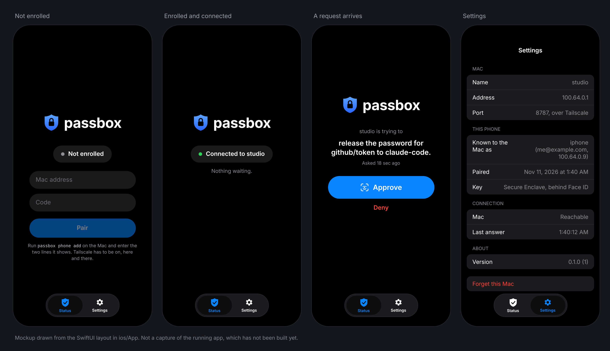

# passbox for iPhone

A second approver for the Mac's Touch ID prompt. When a prompt on the Mac goes unanswered, or the lid is closed, the request appears here and Face ID answers it.

Status: it builds and opens in the simulator, and has not yet run on a device. The protocol and both encryption formats are tested, on Linux, against the broker's own. The Secure Enclave key, the keychain item and the network code compile and have not run against a broker.

There are no notifications yet. The app sees a request while it is open.



A mockup drawn from the SwiftUI layout, to be replaced by captures once the app has run.

## Build

```bash
brew install xcodegen
cd ios
xcodegen
open Passbox.xcodeproj
```

Pick your iPhone and run. The project is generated from `project.yml`, so nothing in Xcode's own format is kept in git. Signing is automatic under the team in that file.

The simulator has no Secure Enclave, so there the key is a software one. That is enough to try the screens against a Mac, and nothing else.

## Pair

On the Mac, with the broker running as a service and the tailnet port exposed, as the main README's [Another machine](../README.md#another-machine) sets up:

```bash
passbox phone add
```

It prints the Mac's tailnet address and a six digit code. Enter both here, press Pair, and touch the sensor on the Mac when it asks to let the phone approve reads. The Mac then sends one test request, which the phone approves with Face ID. After that the pairing is in use.

Tailscale has to be on, on both.

## What is where

| Path | What |
|---|---|
| `Core/` | A Swift package with no screen in it: the wire protocol, opening the wrap, sealing the answer. `swift test` runs it on a Mac or on Linux |
| `App/PhoneKey.swift` | The key in the Secure Enclave, and Face ID |
| `App/Pairing.swift` | What the phone remembers, as one keychain item that stays on this device |
| `App/Tailnet.swift` | One line to the broker and one line back |
| `App/Model.swift` | The state the screens show, and the call held open to the Mac |
| `App/ContentView.swift`, `App/InfoView.swift` | The Status tab and the Settings tab |

## Test

```bash
swift test --package-path ios/Core
```

One test pins the bytes of a sealed answer. The same bytes are pinned in `src/broker/phone.rs`, where the broker opens them, and they came from a third implementation. So the app and the broker each prove they agree with the format without needing the other's toolchain.

The reasoning behind the whole design is in [docs/content/design.md](../docs/content/design.md#a-phone-as-a-second-approver).
